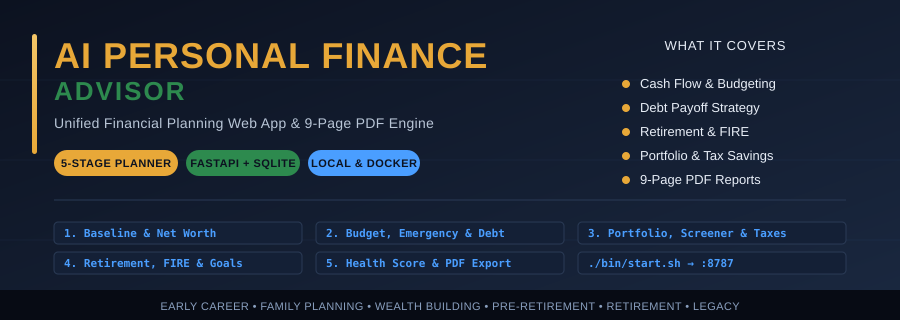

# AI Personal Finance Advisor

> **Full-Stack Personal Financial Planning Web App, Deterministic Calculation Engine, SQLite Persistence, and 9-Page PDF Report Generator.**

> ⚠️ **This is NOT financial advice.** This tool is for informational and educational purposes only. Consult a licensed financial advisor, CPA, or attorney before making any financial decisions.


---

## ⭐ Overview

`ai-finance` combines a **unified single-port FastAPI + static web app** (`http://localhost:8787`) with **Antigravity (AGY) workspace skills** (`.agents/skills/`).

Everything runs locally on your machine with **zero external LLM API keys or token costs** required for the web app:
- **Interactive 5-Stage Financial Planning UI** covering 14 deterministic modules across Baseline, Foundation, Growth, Horizons, and Synthesis.
- **SQLite Persistence (`data/ai_finance.db`)** with user accounts (seeded default `user` / `password` plus registration), saved plans, and per-module history.
- **Professional 9-Page PDF Reports (`FINANCE-PLAN.pdf`)** generated via ReportLab with score gauges, category bars, allocation pie charts, payoff timelines, and a 90-day action plan.
- **Single-Port Docker & Cross-Platform Launchers** for macOS, Linux, and Windows.

---

## 🚀 Quick Start

### 1. Clone the Repository
```bash
git clone https://github.com/pmishra02138/ai-finance.git
cd ai-finance
```

### 2. Start the Web App (Port `8787`)

**macOS / Linux (local `uv`):**
```bash
./bin/start.sh
```

**macOS / Linux (Docker):**
```bash
./bin/start.sh --docker
```

**Windows (PowerShell):**
```powershell
.\bin\start.ps1
# or with Docker:
.\bin\start.ps1 -Docker
```

Open **`http://localhost:8787`** in your browser and sign in with **`user`** / **`password`** (or register a new account).

**Stop the server:**
- macOS / Linux: `./bin/stop.sh`
- Windows: `.\bin\stop.ps1`

---

## 🧭 5-Stage Planning Workflow (14 Modules)

| Stage | Modules | What You Can Analyze |
| :--- | :--- | :--- |
| **1. Baseline & Triage** | Quick Snapshot, Net Worth Tracker | Savings rate, DTI, reserve coverage, balance sheet, Millionaire Next Door tier, wealth milestones |
| **2. Foundation & Defense** | Budget & Cash Flow, Emergency Fund, Debt Payoff | 50/30/20 split, target runway (3–12 months), Avalanche vs. Snowball payoff comparison |
| **3. Growth & Optimization** | Portfolio Review, Investment Screener, Tax Optimization | Age-based allocation drift & rebalancing trades, model ETF strategies, 401(k)/HSA/IRA + age 50+ catch-up savings |
| **4. Horizons & Trade-Offs** | Retirement Planner, FIRE Calculator, Goal Planner, Scenario Compare | 25x rule projections (5%/6%/7%), Lean/Regular/Fat/Coast FI, goal savings timelines, 10-year A vs. B comparisons |
| **5. Synthesis & Export** | Full Health Analysis, PDF Report Export | Composite Financial Health Score (0–100), letter grade (`A+`–`F`), and 9-page `FINANCE-PLAN.pdf` export |

Clicking **Run & Sync to Plan** in any module updates your master plan in SQLite and automatically recalculates your overall Financial Health Score, grade, and signal.

---

## 📄 CLI PDF Generation & Testing

### Generate a Demo PDF via CLI
```bash
uv sync --no-install-project --no-dev
uv run --no-sync python scripts/generate_finance_pdf.py --demo
# → FINANCE-PLAN-sample.pdf
```

Or using a custom JSON file:
```bash
uv run --no-sync python scripts/generate_finance_pdf.py --data plan.json --output FINANCE-PLAN.pdf
```

### Run the Test Suite
```bash
uv run --no-sync python -m unittest discover -s tests -v
```

### Install Antigravity (AGY) Skills Globally (Optional)
Workspace skills are pre-wired under `.agents/skills/`. To install them globally into `~/.gemini/antigravity/skills/` (or start Docker):
```bash
./install.sh --local    # or ./install.sh --docker
./uninstall.sh
```

---

## 🏗️ Project Structure

```text
ai-finance/
├── .agents/skills/              # AGY workspace skill symlinks
├── bin/                         # Cross-platform start/stop scripts
│   ├── start.sh / stop.sh       # macOS & Linux launchers
│   └── start.ps1 / stop.ps1     # Windows PowerShell launchers
├── finance/SKILL.md             # Main AGY orchestrator skill
├── skills/finance-*/SKILL.md    # 14 specialized AGY sub-skills
├── frontend/public/             # Static SPA (index.html, styles.css, app.js, skills.js, charts.js)
├── scripts/
│   ├── server.py                # Unified single-port FastAPI + static frontend server (8787)
│   ├── db.py                    # SQLite persistence (users, sessions, financial_plans, skill_runs)
│   ├── calculators.py           # Deterministic calculation engine for all 14 modules
│   ├── skill_registry.py        # 5-stage catalog & user-facing descriptions
│   └── generate_finance_pdf.py  # ReportLab 9-page PDF generator
├── tests/
│   ├── test_calculators.py      # Unit tests for all 14 calculators
│   └── test_e2e.py              # Full-stack E2E tests (DB, Auth, API, UI, PDF, installers)
├── Dockerfile
├── docker-compose.yml
├── pyproject.toml
├── requirements.txt
├── install.sh / uninstall.sh
├── AGENTS.md
└── README.md
```

---

## 📜 License

[MIT License](LICENSE) — Free to use and modify.

---

## ⚠️ Disclaimer

**This software is NOT financial advice.**

This tool is provided for informational and educational purposes only. The Financial Health Score, projections, recommendations, and any output generated by this software are based on inputs provided by the user and general financial principles, and should NOT be relied upon as a substitute for personalized advice from:

- A **licensed financial advisor** (CFP, CFA, fiduciary)
- A **Certified Public Accountant (CPA)** for tax matters
- An **attorney** for estate, legal, or contractual matters
- An **insurance professional** for coverage decisions

**Past performance does not guarantee future results.** Projections involve assumptions about market returns, inflation, and personal circumstances that may not match real-world outcomes.

---

## 🙏 Acknowledgments

Originally based on [zubair-trabzada/ai-finance-claude](https://github.com/zubair-trabzada/ai-finance-claude).
