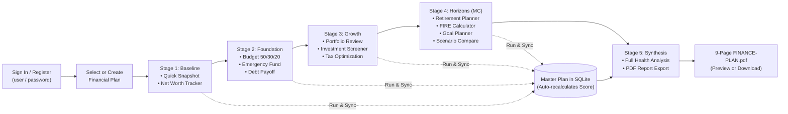
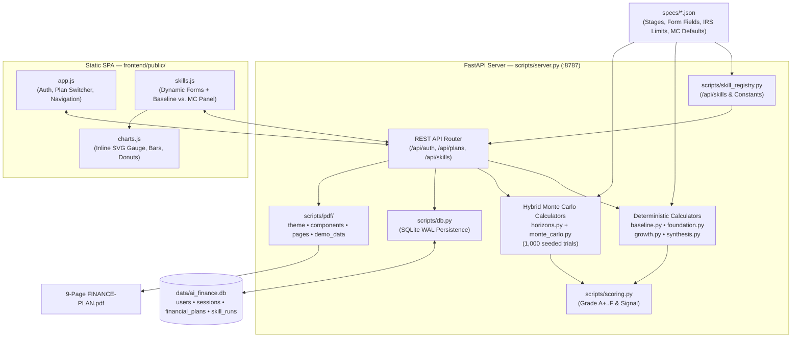
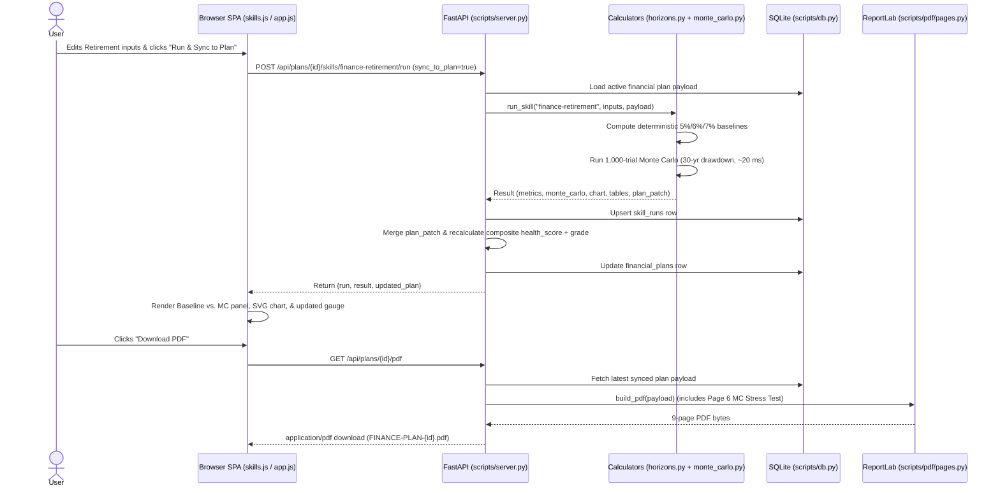
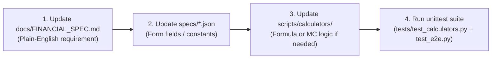

# Visual Workflow & Architecture Guide (`ai-finance`)

> Visual overview of how users move through the 5-stage planning workflow, how `specs/*.json` powers both the UI and backend, and how Deterministic + Monte Carlo calculations sync into SQLite and the 9-page PDF report.
>
> For detailed formulas and scoring rules, see [FINANCIAL_SPEC.md](FINANCIAL_SPEC.md).

---

## 1. 5-Stage Guided User Workflow

Users can work top-to-bottom or jump to any module. Clicking **Run & Sync to Plan** saves that module's inputs/results, patches the active financial plan in SQLite, and automatically recalculates the composite Financial Health Score.

---

## 2. System Architecture & Single Source of Truth

Everything runs on a **single port (`http://localhost:8787`)** via FastAPI + Uvicorn. The 5 JSON files in `specs/` drive both the dynamic browser forms and backend domain constants, while calculations are split cleanly between deterministic math and pure-stdlib Monte Carlo simulations.

---

## 3. Run & Sync + PDF Export Lifecycle

What happens step-by-step when a user runs a Stage 4 module (such as **Retirement Planner**) with **Run & Sync to Plan**, then exports their PDF report:

---

## 4. How to Update Rules or Add Fields

